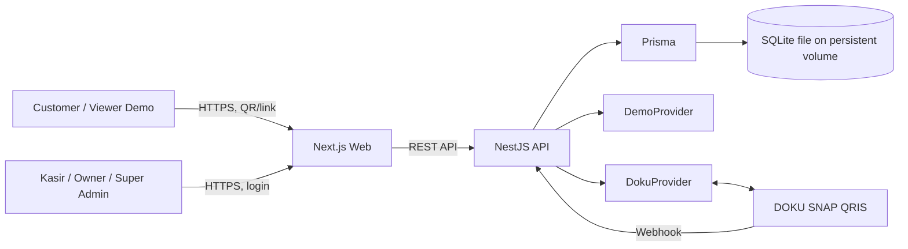

# Architecture — Web Demo Publik

## 1. Tujuan

Membangun aplikasi web multi-tenant untuk brand kedai minuman dengan menu publik, keranjang, checkout, pembayaran QRIS, pelacakan status order, dan dashboard operasional.

## 2. Stack

| Lapisan | Teknologi | Tanggung jawab |
|---|---|---|
| Customer web | Next.js App Router + TypeScript | Menu publik, cart, checkout, status order |
| Dashboard | Next.js + shadcn/ui + Tailwind | Operasional kasir, pengelolaan menu, laporan, admin |
| Client state | Zustand + persist | Keranjang per outlet |
| Server state | TanStack Query v5 | Fetch API, polling status order |
| Form | React Hook Form + Zod | Validasi form dan kontrak input |
| API | NestJS + TypeScript | REST API, auth, order, payment, webhook, cron |
| ORM | Prisma | Akses data dan migrasi |
| Database | SQLite | Penyimpanan utama MVP |
| Payment | `PaymentProvider` interface | Implementasi `DemoProvider` dan `DokuProvider` |
| Deployment | Docker + Coolify | Menjalankan frontend, backend, dan persistent storage |

## 3. Diagram konteks



## 4. Batas aplikasi

Repositori menggunakan dua aplikasi utama:

```text
repo/
├── frontend/                 # Next.js customer web + dashboard
├── backend/                  # NestJS REST API + webhook + scheduled tasks
├── docs/
│   ├── architecture.md
│   ├── database.md
│   ├── api.md
│   ├── payment-qris.md
│   ├── security.md
│   ├── deployment.md
│   └── decisions/
├── docker-compose.yml
└── README.md
```

## 5. Modul backend

| Modul | Tanggung jawab |
|---|---|
| `auth` | Login, refresh, logout, identitas pengguna |
| `users` | CRUD akun dan role |
| `brands` | Tenant/brand |
| `outlets` | Outlet di bawah brand |
| `menu` | Category, MenuItem, OptionGroup, OptionChoice, override outlet |
| `orders` | Pembuatan order, kalkulasi harga, transisi status |
| `payments` | Provider, QRIS, status pembayaran, regenerasi QR |
| `webhooks` | Validasi notifikasi pembayaran |
| `reports` | Ringkasan order dan omzet |
| `qr` | Generator QR link outlet/meja |
| `uploads` | Validasi dan penyimpanan foto menu |
| `health` | Health check |

Pola modul: `Controller → Service → Prisma`. Validasi input menggunakan DTO dan `ValidationPipe` global. Controller tidak boleh menjadi tempat logika bisnis.

## 6. Multi-tenancy

- `Brand` adalah tenant.
- `Outlet` dimiliki oleh satu `Brand`.
- Data menu dan konfigurasi pembayaran memiliki scope brand.
- Order, ketersediaan menu, dan override harga memiliki scope outlet.
- Setiap request dashboard wajib melewati autentikasi, pemeriksaan role, dan pemeriksaan tenant.
- Jangan percaya `brandId` atau `outletId` dari client sebagai bukti akses. Scope harus diturunkan dari sesi pengguna dan resource yang diminta.
- Untuk MVP, tenant berada pada satu file SQLite. Semua query tetap harus dibatasi tenant secara eksplisit.

## 7. Alur utama

### Customer order

1. Customer membuka `/{brandSlug}/{outletSlug}` atau QR meja dengan query `?table=<kode>`.
2. Frontend mengambil menu untuk outlet.
3. Cart disimpan lokal dan dipisahkan per outlet.
4. Customer mengirim checkout ke API.
5. Backend mengambil harga dan ketersediaan dari database, menghitung total ulang, lalu membuat order dalam transaksi.
6. Backend membuat payment sesuai mode pembayaran brand dan metode yang dipilih.
7. Frontend menampilkan QR dan memantau status order melalui polling setiap 3 detik.
8. Status berubah setelah callback terverifikasi atau hasil query status provider.

### Operasional kasir

1. Kasir login.
2. API membatasi order ke outlet yang boleh diakses kasir.
3. Dashboard polling setiap 5 detik.
4. Kasir memperbarui status order atau menandai pembayaran tunai sesuai aturan transisi.

## 8. Status order

Alur normal:

```text
PENDING_PAYMENT → PAID → PREPARING → READY → COMPLETED
```

Status akhir/cabang: `EXPIRED`, `CANCELLED`.

Pisahkan status order dan status payment. Pembayaran yang berhasil tidak otomatis berarti order selesai diproses.

## 9. Strategi polling

- Customer: polling status order setiap 3 detik; berhenti ketika status final.
- Dashboard kasir: polling order setiap 5 detik.
- Rekonsiliasi payment: task berkala untuk payment yang masih pending.
- Webhook tetap menjadi jalur notifikasi utama untuk DOKU; hasil webhook diverifikasi dengan query status provider sesuai kontrak DOKU yang telah diverifikasi.

Redis, WebSocket, dan SSE tidak termasuk MVP.

## 10. Transaksi dan konsistensi

- Pembuatan order dan item order harus atomik.
- Total order dihitung di backend dari harga database, bukan dari total yang dikirim browser.
- Simpan snapshot nama item, harga, opsi, dan harga tambahan pada detail order agar histori tidak berubah saat menu diedit.
- Webhook harus idempoten. Event/callback yang sama tidak boleh menggandakan perubahan status.
- Gunakan unique constraint untuk kode order dan referensi provider yang memang dijamin unik.
- Untuk SQLite, minimalkan durasi transaksi tulis dan jangan melakukan request jaringan ke DOKU di tengah transaksi database yang terbuka.

## 11. Batasan dan trade-off SQLite

SQLite dipilih untuk MVP karena operasional sederhana dan tidak membutuhkan server database terpisah.

Konsekuensi:
- Satu file database harus dipasang pada persistent volume.
- SQLite mengizinkan banyak pembaca tetapi penulisan bersamaan lebih terbatas dibanding database server.
- Jalankan satu instance backend yang menulis ke file database yang sama.
- Jangan menempatkan file database pada filesystem ephemeral atau berbagi file SQLite melalui network filesystem tanpa validasi dukungan dan perilaku locking.
- WAL mode dapat dipertimbangkan setelah diuji pada lingkungan deployment. Backup harus konsisten dengan mode jurnal yang digunakan.
- Jika membutuhkan beberapa backend instance aktif, throughput tulis tinggi, atau pemisahan database per tenant, evaluasi migrasi ke PostgreSQL.

## 12. Keputusan yang masih perlu dikunci

- Apakah user kasir dapat ditautkan ke satu outlet saja atau beberapa outlet.
- Kebijakan penghapusan/retensi order dan data pelanggan.
- Penyimpanan foto menu: volume lokal atau object storage.
- Format final kode order dan aturan reset nomor harian.
- Detail endpoint/token/signature DOKU wajib diverifikasi dari dokumentasi resmi sebelum implementasi; jangan menebak spesifikasi yang belum terkonfirmasi.
