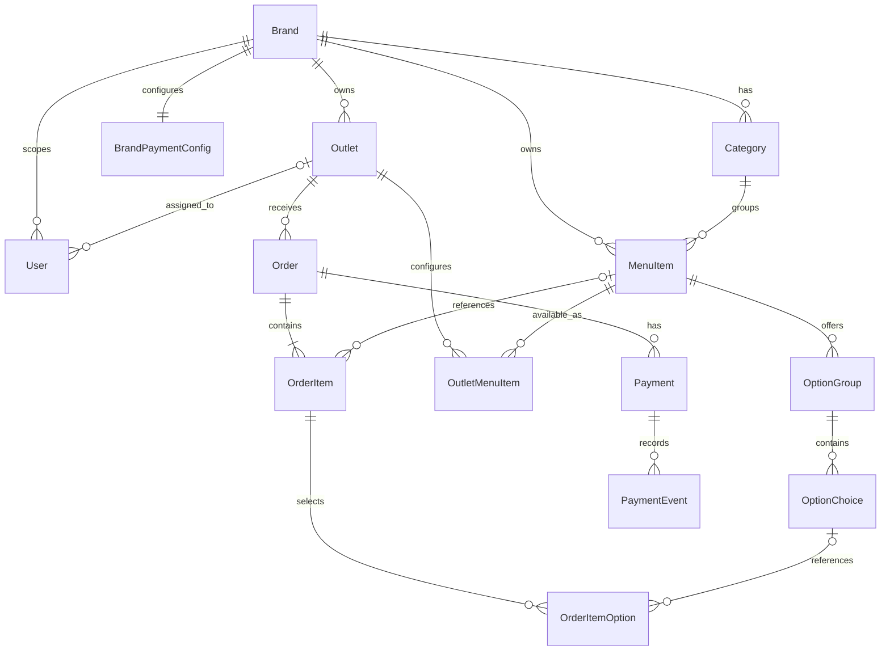

# Database Design — SQLite + Prisma

## 1. Prinsip desain

- Database MVP: SQLite.
- ORM: Prisma.
- `Brand` merupakan tenant.
- Foreign key harus diaktifkan dan diuji pada koneksi SQLite.
- Harga disimpan sebagai integer dalam satuan rupiah, bukan floating point.
- Timestamp disimpan konsisten dalam UTC; konversi zona waktu dilakukan pada layer aplikasi.
- Simpan snapshot nama dan harga pada item order untuk menjaga histori transaksi.
- Gunakan transaksi untuk pembuatan order dan perubahan status yang harus atomik.

## 2. Entitas

| Model | Fungsi |
|---|---|
| `Brand` | Tenant/brand minuman |
| `Outlet` | Cabang/outlet milik brand |
| `User` | Akun admin, owner, atau kasir |
| `BrandPaymentConfig` | Mode pembayaran dan kredensial gateway per brand |
| `Category` | Kategori menu |
| `MenuItem` | Definisi menu di tingkat brand |
| `OptionGroup` | Grup opsi menu, misalnya ukuran atau tingkat gula |
| `OptionChoice` | Pilihan dalam grup opsi |
| `OutletMenuItem` | Harga override dan ketersediaan item per outlet |
| `Order` | Header pesanan |
| `OrderItem` | Baris item pesanan |
| `OrderItemOption` | Snapshot opsi yang dipilih pada baris pesanan |
| `Payment` | Satu percobaan/record pembayaran untuk order |
| `PaymentEvent` | Audit trail perubahan dan notifikasi pembayaran |

## 3. Relasi



## 4. Field penting per model

Field di bawah adalah baseline desain. Nama, nullability, panjang, dan default final harus dicocokkan dengan kontrak API dan schema Prisma saat implementasi.

### `Brand`
- `id`: primary key.
- `name`: nama brand.
- `slug`: unik secara global untuk URL.
- `createdAt`, `updatedAt`.

### `Outlet`
- `id`, `brandId`, `name`, `slug`.
- `slug` unik dalam satu brand; route menggunakan pasangan brand slug dan outlet slug.
- `isActive`, `createdAt`, `updatedAt`.
- Constraint unik yang disarankan: `(brandId, slug)`.

### `User`
- `id`, `brandId?`, `outletId?`, `name`, `email`, `passwordHash`, `role`.
- `email` unik global untuk alur login sederhana.
- Role: `SUPER_ADMIN`, `OWNER`, `CASHIER`.
- `brandId` dan `outletId` nullable sesuai role; aturan akses wajib ditegakkan di service/guard.
- Untuk kebutuhan kasir yang dapat mengakses banyak outlet, gunakan tabel penghubung `UserOutlet` sebagai pengembangan terencana, bukan memaksakan satu `outletId`.

### `BrandPaymentConfig`
- `id`, `brandId` unik, `mode`, `encryptedCredentials?`, `createdAt`, `updatedAt`.
- Mode: `demo`, `doku_sandbox`, `doku_live`.
- Kredensial dienkripsi di backend. Secret tidak pernah dikirim ke frontend.
- Di SQLite/Prisma, enum native tidak tersedia seperti pada PostgreSQL. Simpan nilai mode sebagai `String` dan validasi menggunakan TypeScript enum/Zod atau constraint yang kompatibel dengan versi Prisma/SQLite yang digunakan.

### `Category`
- `id`, `brandId`, `name`, `sortOrder`, timestamps.
- Index pada `brandId`.

### `MenuItem`
- `id`, `brandId`, `categoryId?`, `name`, `description?`, `imageUrl?`, `basePrice`, `isActive`, timestamps.
- `basePrice`: integer rupiah.
- `categoryId` nullable bila menu boleh tanpa kategori; bila tidak, jadikan wajib.

### `OptionGroup`
- `id`, `menuItemId`, `name`, `selectionType`, `isRequired`, `minSelections?`, `maxSelections?`, `sortOrder`.
- `selectionType`: `single` atau `multi`, divalidasi di aplikasi.

### `OptionChoice`
- `id`, `optionGroupId`, `name`, `additionalPrice`, `isAvailable`, `sortOrder`.
- `additionalPrice`: integer rupiah; dapat bernilai 0.

### `OutletMenuItem`
- `id`, `outletId`, `menuItemId`, `priceOverride?`, `isAvailable`.
- Constraint unik: `(outletId, menuItemId)`.
- Harga efektif: `priceOverride` jika ada, selain itu `MenuItem.basePrice`.
- Ketersediaan outlet harus diperiksa saat menu ditampilkan dan saat checkout.

### `Order`
- `id`, `outletId`, `orderCode`, `orderNumber`, `businessDate`, `customerName`, `whatsapp?`, `tableCode?`, `orderType`, `status`, `paymentMethod`, `subtotal`, `totalAmount`, `createdAt`, `updatedAt`.
- `orderCode` unik global untuk pencarian status publik.
- Constraint unik yang disarankan untuk nomor harian: `(outletId, businessDate, orderNumber)`.
- `orderType`: `DINE_IN` atau `TAKE_AWAY`.
- Status: `PENDING_PAYMENT`, `PAID`, `PREPARING`, `READY`, `COMPLETED`, `EXPIRED`, `CANCELLED`.
- Tentukan aturan transisi status di service, bukan hanya di UI.

### `OrderItem`
- `id`, `orderId`, `menuItemId?`, `itemNameSnapshot`, `unitPrice`, `quantity`, `notes?`, `lineTotal`.
- `menuItemId` boleh nullable agar histori tetap valid jika menu dihapus; alternatifnya soft-delete menu dan pertahankan FK wajib.
- `unitPrice`, `lineTotal`: integer rupiah.
- `quantity` harus integer positif.

### `OrderItemOption`
- `id`, `orderItemId`, `optionChoiceId?`, `optionGroupNameSnapshot`, `choiceNameSnapshot`, `additionalPriceSnapshot`.
- Snapshot menyimpan nama dan harga saat transaksi.
- `optionChoiceId` nullable untuk mempertahankan histori ketika pilihan menu dihapus.

### `Payment`
- `id`, `orderId`, `provider`, `status`, `amount`, `partnerReferenceNo?`, `providerReference?`, `qrContent?`, `expiresAt?`, `paidAt?`, `createdAt`, `updatedAt`.
- `amount`: integer rupiah.
- `partnerReferenceNo` harus unik jika provider mensyaratkannya unik; implementasikan unique index dengan mempertimbangkan nilai null.
- Satu order dapat memiliki beberapa payment record karena QR dapat dibuat ulang setelah expired. Tentukan apakah record lama di-expire sebelum record baru dibuat.

### `PaymentEvent`
- `id`, `paymentId`, `eventType`, `providerEventId?`, `payloadJson?`, `verificationResult`, `createdAt`.
- `providerEventId` dapat diberi unique constraint jika provider menyediakan identifier event yang stabil.
- Jangan simpan secret, access token, atau data sensitif mentah dalam payload log.
- Payload webhook perlu dibatasi ukuran dan disanitasi sebelum disimpan.

## 5. Constraint dan index minimum

- `Brand.slug` unique.
- `Outlet`: unique `(brandId, slug)`.
- `User.email` unique.
- `BrandPaymentConfig.brandId` unique.
- `OutletMenuItem`: unique `(outletId, menuItemId)`.
- `Order.orderCode` unique.
- `Order`: unique `(outletId, businessDate, orderNumber)`.
- Index foreign key yang sering dipakai untuk filter: `Outlet.brandId`, `User.brandId`, `User.outletId`, `Category.brandId`, `MenuItem.brandId`, `MenuItem.categoryId`, `Order.outletId`, `Order.status`, `Order.createdAt`, `Payment.orderId`, `Payment.status`, `PaymentEvent.paymentId`.
- Tambahkan index sesuai query nyata setelah profiling; jangan membuat index berlebihan.

## 6. SQLite-specific

- Prisma datasource menggunakan `provider = "sqlite"`.
- SQLite menyimpan database dalam satu file, misalnya `file:./dev.db` untuk lokal. Path produksi harus diarahkan ke persistent volume dan diverifikasi sesuai konfigurasi Prisma v7.
- Pastikan `PRAGMA foreign_keys = ON` pada koneksi yang digunakan dan uji constraint FK dalam test.
- Nilai uang berupa integer rupiah; hindari `Float` untuk perhitungan nominal.
- Prisma/SQLite memiliki perbedaan dukungan tipe dan enum dibanding PostgreSQL. Gunakan `String` + validasi aplikasi untuk role, status, mode, dan jenis order bila enum tidak didukung oleh kombinasi versi Prisma yang dipakai.
- Unique index pada kolom nullable mengikuti semantik SQLite: beberapa nilai `NULL` dapat tetap lolos pada unique index. Jangan mengandalkan unique nullable field untuk mencegah duplikasi event tanpa strategi tambahan.
- SQLite tidak cocok untuk banyak writer bersamaan. Gunakan satu instance backend untuk file database yang sama dan ukur beban tulis.
- Migrasi Prisma harus diuji pada salinan database sebelum diterapkan ke data produksi.

## 7. Prisma schema: contoh awal

Contoh ini merupakan kerangka inti, bukan schema final lengkap. Sesuaikan generator dan konfigurasi Prisma dengan versi Prisma yang dipasang.

```prisma
generator client {
  provider = "prisma-client"
  output   = "../generated/prisma"
}

datasource db {
  provider = "sqlite"
}

model Brand {
  id          String   @id @default(cuid())
  name        String
  slug        String   @unique
  createdAt   DateTime @default(now())
  updatedAt   DateTime @updatedAt

  outlets     Outlet[]
  users       User[]
  categories  Category[]
  menuItems   MenuItem[]
  paymentConfig BrandPaymentConfig?
}

model Outlet {
  id        String   @id @default(cuid())
  brandId   String
  name      String
  slug      String
  isActive  Boolean  @default(true)
  createdAt DateTime @default(now())
  updatedAt DateTime @updatedAt

  brand     Brand    @relation(fields: [brandId], references: [id], onDelete: Cascade)
  users     User[]
  menuItems OutletMenuItem[]
  orders    Order[]

  @@unique([brandId, slug])
  @@index([brandId])
}

model User {
  id           String   @id @default(cuid())
  brandId      String?
  outletId     String?
  name         String
  email        String   @unique
  passwordHash String
  role         String
  createdAt    DateTime @default(now())
  updatedAt    DateTime @updatedAt

  brand        Brand?   @relation(fields: [brandId], references: [id], onDelete: Cascade)
  outlet       Outlet?  @relation(fields: [outletId], references: [id], onDelete: SetNull)

  @@index([brandId])
  @@index([outletId])
}

model BrandPaymentConfig {
  id                  String   @id @default(cuid())
  brandId             String   @unique
  mode                String
  encryptedCredentials String?
  createdAt           DateTime @default(now())
  updatedAt           DateTime @updatedAt

  brand Brand @relation(fields: [brandId], references: [id], onDelete: Cascade)
}
```

> Catatan Prisma v7: letakkan URL database pada `prisma.config.ts` sesuai konfigurasi versi yang terpasang; datasource pada schema di atas tidak memuat `url`. Untuk runtime, konfigurasi Prisma Client dan driver adapter SQLite harus disesuaikan dengan adapter yang dipilih serta diuji pada deployment. Contoh ini hanya menunjukkan model inti, bukan schema produksi lengkap.

## 8. Transaksi pembuatan order

1. Validasi outlet aktif dan item masih tersedia.
2. Baca harga dasar, override outlet, dan pilihan opsi dari database.
3. Hitung subtotal dan total di backend.
4. Dalam transaksi singkat, buat `Order` dan semua `OrderItem`/`OrderItemOption`.
5. Commit transaksi.
6. Buat payment melalui provider di luar transaksi database.
7. Simpan hasil payment dengan operasi database tersendiri.
8. Jika pembuatan payment gagal, simpan error/status yang dapat direkonsiliasi dan tampilkan alur retry yang aman.

## 9. Retensi dan backup

- PRD menetapkan retensi data pelanggan 12 bulan; tentukan apakah order transaksi mengikuti periode yang sama atau kebijakan terpisah.
- Backup file SQLite harus konsisten. Pilih mekanisme backup SQLite yang aman terhadap mode jurnal aktif; jangan hanya menyalin file database saat sedang ada transaksi tanpa prosedur yang tepat.
- Uji restore backup secara berkala.
